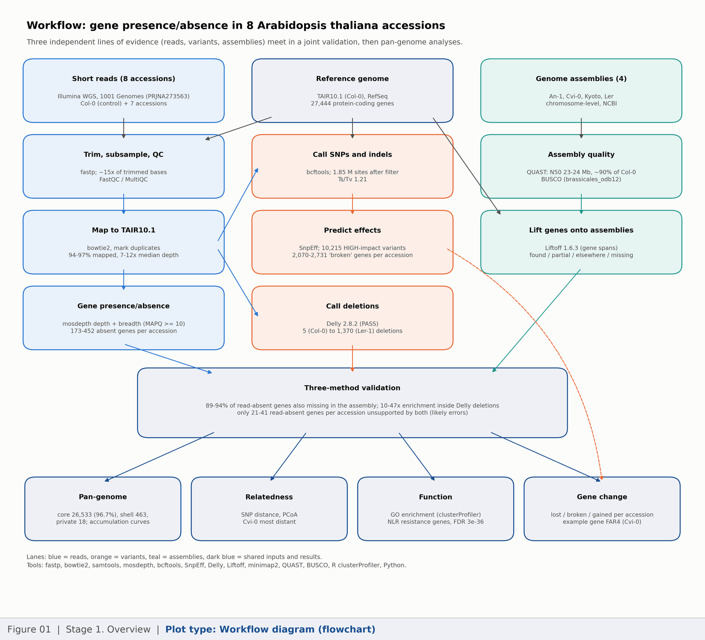
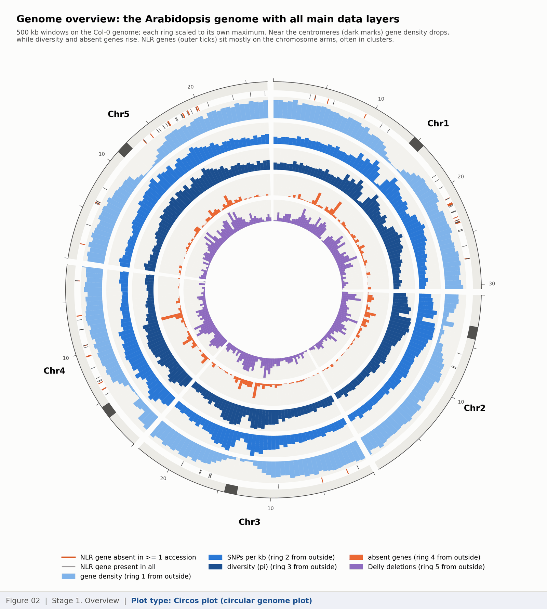
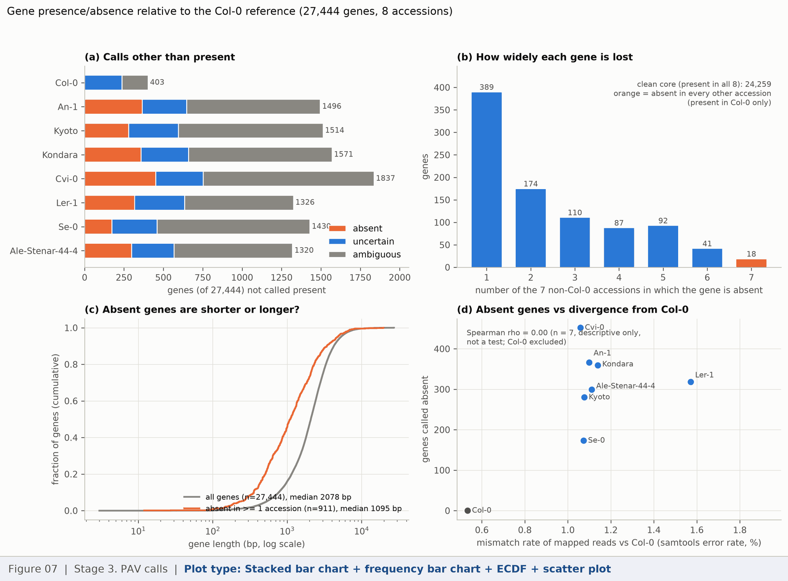
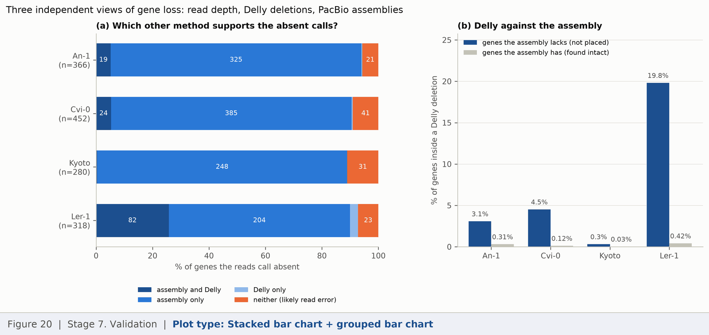
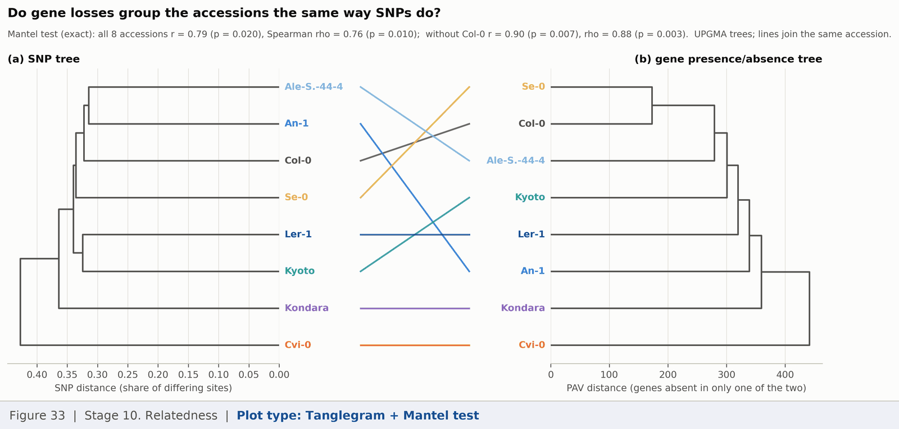
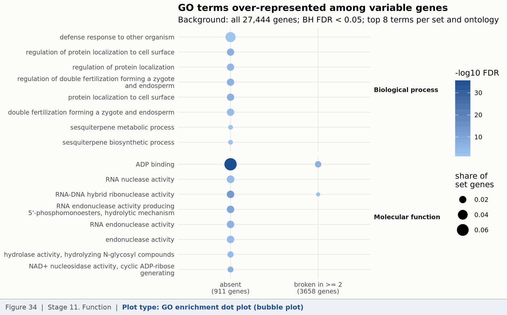
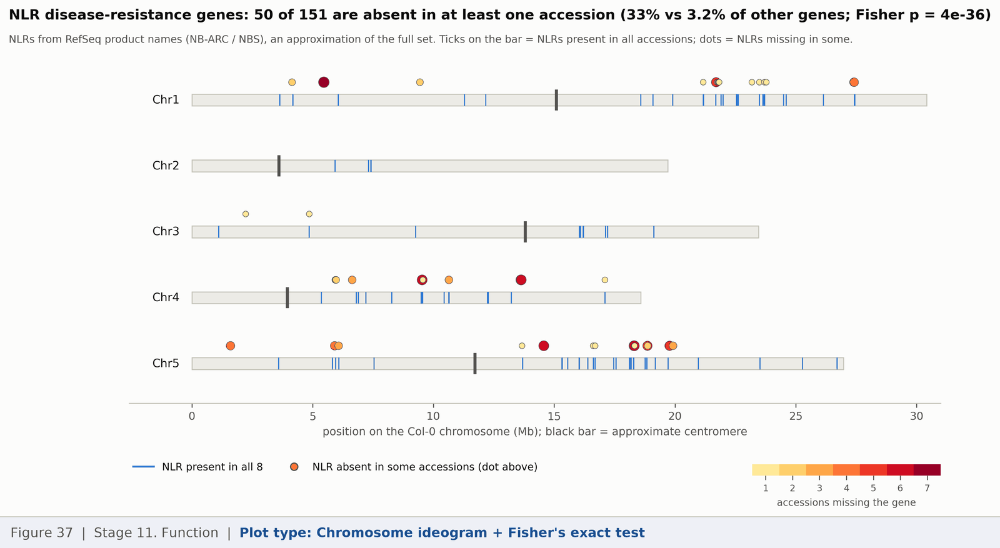
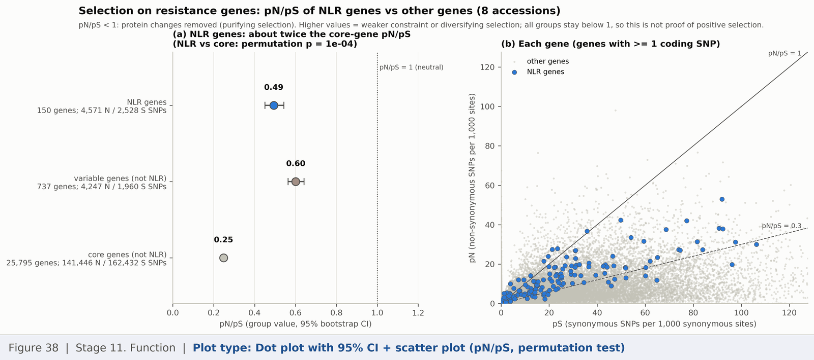

# Gene presence/absence pan-genome of 8 *Arabidopsis thaliana* accessions

Which genes are missing in some natural accessions of *Arabidopsis thaliana*? Are those calls real? And what kinds
of genes are they? Short reads of 8 accessions (Col-0, An-1, Kyoto, Kondara, Cvi-0, Ler-1, Se-0, Ale-Stenar-44-4)
were mapped to the TAIR10.1 (Col-0) reference. Gene presence/absence (PAV) was called from read depth, then checked
against Delly deletions and 4 genome assemblies.



## Main results

| Question | Result |
|---|---|
| How many genes are missing? | 173-452 genes absent per accession (0.6-1.7%); 911 of 27,444 genes absent in at least one; Col-0 control: 0 |
| Are the calls real? | 89-94% of read-absent genes are also missing in the assembly; absent genes lie inside Delly deletions 8-76x more often; only 21-41 per accession lack support from both |
| Pan-genome | Core 26,533 genes (96.7%), soft-core 389, shell 463; the core is still shrinking at 8 accessions |
| Lost vs broken | Genes broken by a HIGH-impact variant (2,070-2,731 per accession) are 6-13x more common than deleted genes |
| Relatedness | Gene-loss distances match SNP distances (Mantel r = 0.79, p = 0.02); Cvi-0 (Cape Verde) is the most distinct |
| What is lost? | NLR disease-resistance genes: 33% are variable vs 3.2% of other genes (Fisher p = 4e-36), mostly in clusters |
| Selection | NLR genes are 2.1x more diverse (pi) and have twice the pN/pS of core genes (0.49 vs 0.25, p = 1e-4) |

## Key figures

| | |
|---|---|
|  |  |
| **02** Circos overview: genes, SNPs, diversity, absences, deletions, NLRs | **07** Absent genes per accession |
|  |  |
| **20** Three methods agree on the absent calls | **33** Gene-loss tree vs SNP tree (Mantel test) |
|  |  |
| **34** GO enrichment of variable genes | **37** NLR genes on the chromosomes |



The full set of 39 figures, in pipeline order with plot types, is described in [docs/figures.md](docs/figures.md).
The figures are rebuilt with the `scripts/plot_*.py` scripts, then `scripts/add_figure_captions.py`.

## Methods

| Step | Tools |
|---|---|
| Reads | ENA short reads, about 15x per accession; fastp, FastQC, MultiQC |
| Mapping | bowtie2 to TAIR10.1, samtools |
| PAV calls | mosdepth per-gene depth (MAPQ >= 10), relative to each sample's median |
| SNPs and effects | bcftools, SnpEff |
| Deletions | Delly 2.8.2 |
| Assemblies | QUAST, BUSCO (brassicales_odb12), Liftoff, minimap2, SyRI + plotsr |
| Statistics | GO enrichment (clusterProfiler, BH FDR), Fisher's exact, Mann-Whitney, Mantel, permutation and bootstrap tests, Wilson CI |

Bioinformatics steps run in WSL Ubuntu with conda environments; figures run in Python (matplotlib) and R.

## Repository

```
scripts/        pipeline and figure scripts
docs/           research_log.md (daily log), figures.md (figure guide), figures/ (key figures)
results/        small result tables, tracked with DVC (remote on DagsHub)
config/, data/meta/   sample tables and accession coordinates
```

Reads, BAM files, assemblies and the full figure set are not in git. They can be downloaded or rebuilt with the
scripts.

## Limits

- Read depth against Col-0 can only find genes that are missing relative to Col-0. Genes absent from Col-0, and
  gene gains, are not seen.
- 8 accessions are too few for a closed pan-genome. Shell and private gene counts are lower bounds.
- The Ler assembly is used as a stand-in for Ler-1.
