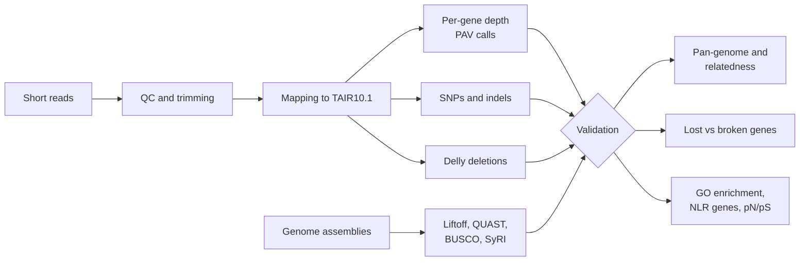

<div align="center">

# Arabidopsis Gene Presence/Absence Pan-Genome

**Natural gene loss across 8 *Arabidopsis thaliana* accessions, validated with three independent methods**


[Overview](#overview) · [Key findings](#key-findings) · [Data](#data) · [Workflow](#workflow) ·
[Reproducing](#reproducing-the-analysis) · [Limitations](#limitations) · [References](#references)

</div>

---

## Overview

Individuals of the same plant species do not carry the same set of genes. This project measures **gene
presence/absence variation (PAV)** in 8 natural accessions of *Arabidopsis thaliana* from Europe, Asia, Africa and
North America. It asks three questions:

1. **How many genes** are missing from each accession compared with the Col-0 reference?
2. **Are the calls real?** Each call is checked with structural-variant calling, genome assemblies and known genes
   from the literature.
3. **Which genes** are lost, and what does that say about their evolution?

Whole-genome short reads were mapped to TAIR10.1. Gene absence was called from read depth, then validated against
Delly deletions, Liftoff placement in 4 chromosome-level assemblies, and published alleles.

## Key findings

| | Result |
|---|---|
| **Gene loss** | 173-452 genes absent per accession (0.6-1.7%); 911 of 27,444 genes absent in at least one accession. Col-0 negative control: 0 |
| **Validation** | 89-94% of read-absent genes are also missing from the assembly; absent genes lie inside Delly deletions 8-76x more often than present genes; only 21-41 calls per accession lack support from both methods |
| **Known genes** | Losses of the resistance genes RPS5 and RPM1 match published presence/absence alleles; the RPS4/RRS1 pair is lost together in Cvi-0; conserved immune genes (ZAR1, ADR1, PBS1) are present in all accessions |
| **Pan-genome** | Core 26,533 genes (96.7%), soft-core 389, shell 463; the core is still shrinking at 8 accessions (open pan-genome) |
| **Broken vs deleted** | Genes disrupted by HIGH-impact variants (2,070-2,731 per accession) outnumber deleted genes 6-13 fold |
| **Population structure** | Gene-loss distances agree with SNP distances (Mantel r = 0.79, p = 0.02); Cvi-0 (Cape Verde) is the most distinct accession |
| **Disease resistance** | NLR immune receptor genes are strongly enriched among variable genes: 33% vs 3.2% (OR 15.2, Fisher p = 4e-36), mostly in genomic clusters |
| **Selection** | NLR genes are 2.1x more diverse (pi, p = 2e-12) and have twice the pN/pS of core genes (0.49 vs 0.25, permutation p = 1e-4) |

## Data

| Accession | Origin | 1001 Genomes ID | Reads (SRA) | Assembly | Absent genes |
|---|---|---|---|---|---|
| Col-0 | USA (reference) | 6909 | SRR1945757 | TAIR10.1 | 0 (control) |
| An-1 | Belgium | 6898 | SRR1945750 | GCA_902460265.3 | 366 |
| Kyoto | Japan | 7207 | SRR1945866 | GCA_902460305.1 | 280 |
| Kondara | Tajikistan | 6929 | SRR1945770 | - | 359 |
| Cvi-0 | Cape Verde | 6911 | SRR1945758 | GCA_902460275.1 | 452 |
| Ler-1 | Germany | 6932 | SRR1945772 | GCA_902460285.1 (Ler) | 318 |
| Se-0 | Spain | 6961 | SRR1945785 | - | 173 |
| Ale-Stenar-44-4 | Sweden | 992 | SRR1945477 | - | 299 |

Reads come from the 1001 Genomes Project (BioProject PRJNA273563), subsampled to about 15x. The chromosome-level
assemblies are from Jiao and Schneeberger (2020).

## Workflow



| Stage | Tools |
|---|---|
| Read QC | fastp, FastQC, MultiQC |
| Mapping | bowtie2, samtools |
| Gene presence/absence | mosdepth (MAPQ >= 10), depth relative to the sample median |
| Small variants | bcftools 1.25, SnpEff 5.4c |
| Structural variants | Delly 2.8.2 |
| Assemblies | Liftoff 1.6.3, minimap2 2.24, QUAST 5.3.0, BUSCO 6.1.0 (brassicales_odb12), SyRI 1.8.2, plotsr 1.2.0 |
| Function | clusterProfiler 4.18.4, org.At.tair.db (GO over-representation, BH FDR) |
| Statistics | Fisher's exact, Mann-Whitney U, Mantel, permutation and bootstrap tests, Wilson intervals, UPGMA, PCoA |
| Visualisation | Python (matplotlib), R (ggplot2), Plotly |

The 39 figures, in pipeline order with their plot types and findings, are described in
[docs/figures.md](docs/figures.md). Eight key figures are in [docs/figures/](docs/figures/).

## Reproducing the analysis

```bash
# 1. get the code and the tracked result tables
git clone https://github.com/manan348/arabidopsis-gene-pav.git
cd arabidopsis-gene-pav
dvc pull                                  # result tables from DagsHub

# 2. raw data (not in git): reads from ENA, assemblies from NCBI
bash scripts/download_reads.sh config/samples.tsv data/meta/selected_runs.tsv data/raw

# 3. the whole pipeline is defined in dvc.yaml (15 stages); `dvc dag` shows it, `dvc repro` re-runs it (WSL).
#    The main steps, one by one (each script documents its inputs, outputs and conda environment):
bash scripts/trim_subsample.sh SAMPLE     # QC and subsampling, per accession
bash scripts/map_sample.sh SAMPLE         # mapping, per accession
bash scripts/pav_depth.sh SAMPLE          # per-gene depth, per accession
python scripts/build_pav.py               # presence/absence calls
bash scripts/call_variants.sh CHROM       # SNPs and indels, per chromosome
bash scripts/call_sv.sh SAMPLE            # Delly deletions, per accession
bash scripts/run_liftoff.sh SAMPLE        # genes on the assemblies (An-1, Cvi-0, Kyoto, Ler-1)
Rscript scripts/go_enrichment.R           # GO enrichment

# 4. figures: run the scripts/plot_*.py scripts (one per figure), then
python scripts/add_figure_captions.py     # caption bands
```

Hardware used: 4 CPU cores and 3.8 GB RAM. All steps fit in this budget.

## Repository structure

```
arabidopsis-gene-pav/
├── dvc.yaml         pipeline: 15 stages from reads to results, with inputs and outputs
├── dvc.lock         hashes of every stage's inputs and outputs
├── config/          sample table (accessions, SRA runs)
├── data/meta/       accession coordinates and download lists
├── docs/            figure guide and key figures
├── scripts/         pipeline, analysis and plotting scripts
└── results/         result tables, outputs of the DVC pipeline (data on DagsHub)
```

Reads, alignments, assemblies and the full figure set are not stored in git.

## Limitations

- Mapping to a single reference only detects genes **missing relative to Col-0**. Genes absent from Col-0, and gene
  gains, are not captured.
- Eight accessions cannot saturate the pan-genome. Shell and private gene counts are lower bounds.
- The NCBI "Ler" assembly is used for the Ler-1 reads.
- Some HIGH-impact variant effects reflect reference bias. For example, FRI is non-functional in Col-0 itself, so
  functional alleles in other accessions appear as frameshifts.
- Nucleotide diversity is a lower bound, because only filtered sites with read coverage are counted.

## References

- 1001 Genomes Consortium (2016). 1,135 genomes reveal the global pattern of polymorphism in *Arabidopsis thaliana*. *Cell* 166, 481-491.
- Jiao W-B, Schneeberger K (2020). Chromosome-level assemblies of multiple *Arabidopsis* genomes reveal hotspots of rearrangements with altered evolutionary dynamics. *Nature Communications* 11, 989.
- Tian D et al. (2002). Signature of balancing selection in *Arabidopsis*. *PNAS* 99, 11525-11530. [doi:10.1073/pnas.172203599](https://doi.org/10.1073/pnas.172203599)
- Grant MR et al. (1998). Independent deletions of a pathogen-resistance gene in *Brassica* and *Arabidopsis*. *PNAS* 95, 15843-15848. [doi:10.1073/pnas.95.26.15843](https://doi.org/10.1073/pnas.95.26.15843)
- Johanson U et al. (2000). Molecular analysis of FRIGIDA, a major determinant of natural variation in *Arabidopsis* flowering time. *Science* 290, 344-347. [doi:10.1126/science.290.5490.344](https://doi.org/10.1126/science.290.5490.344)
- Gazzani S et al. (2003). Analysis of the molecular basis of flowering time variation in *Arabidopsis* accessions. *Plant Physiology* 132, 1107-1114. [doi:10.1104/pp.103.021212](https://doi.org/10.1104/pp.103.021212)
